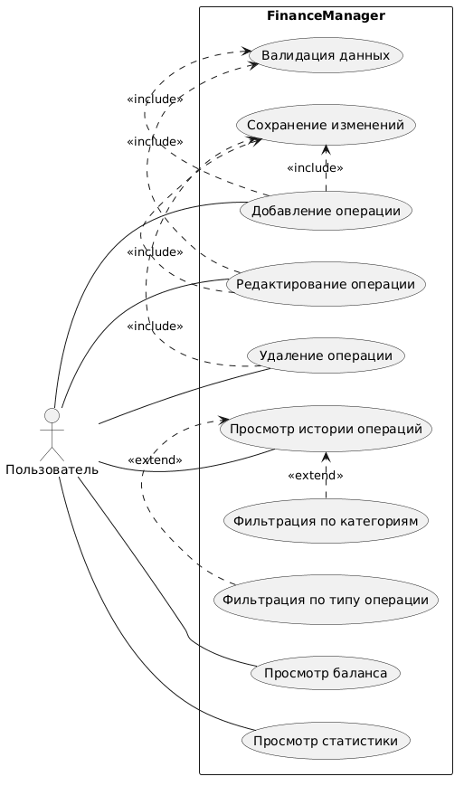
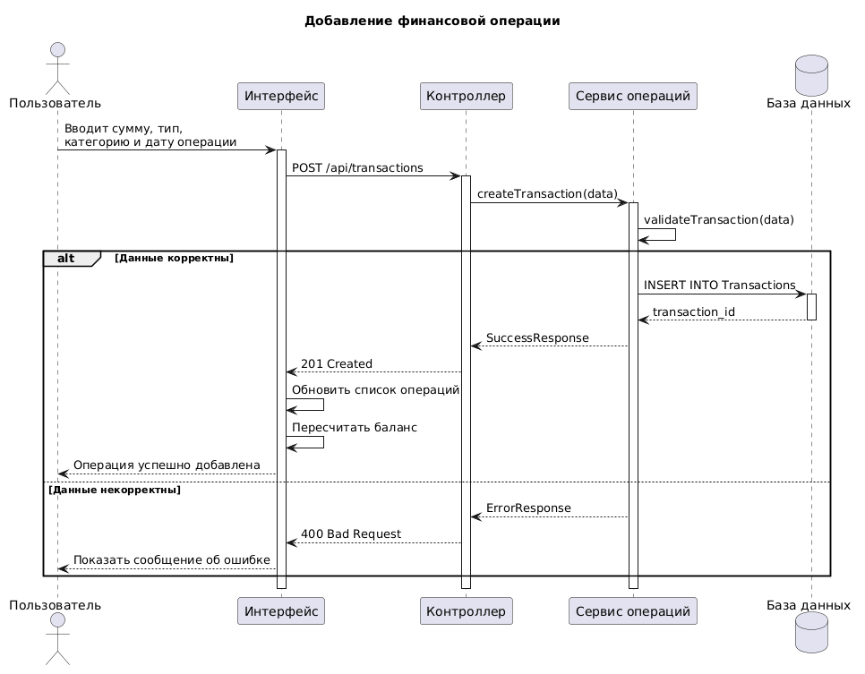
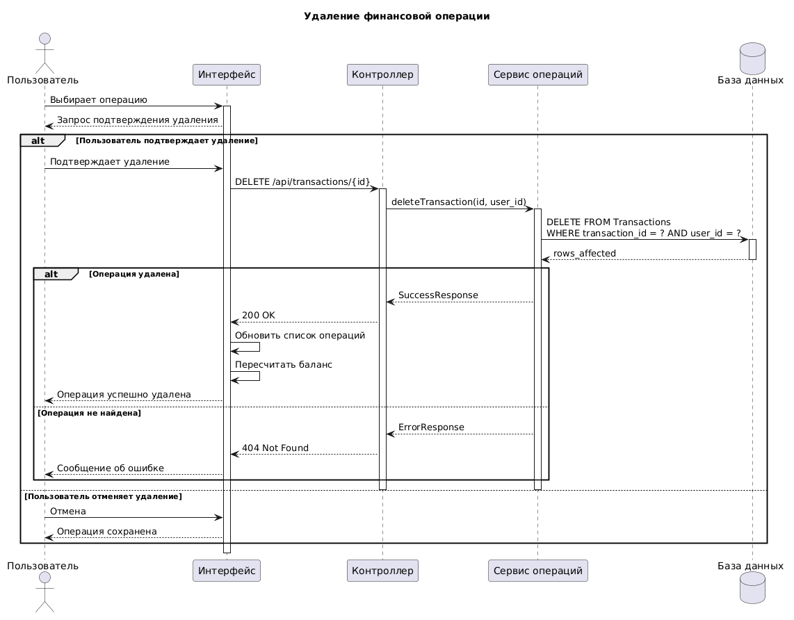
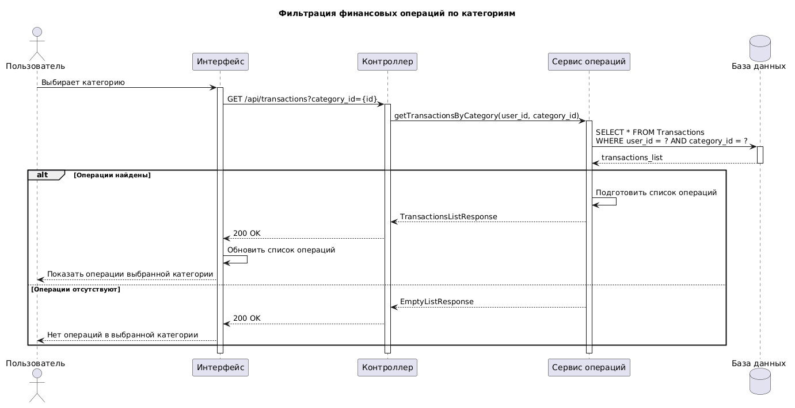
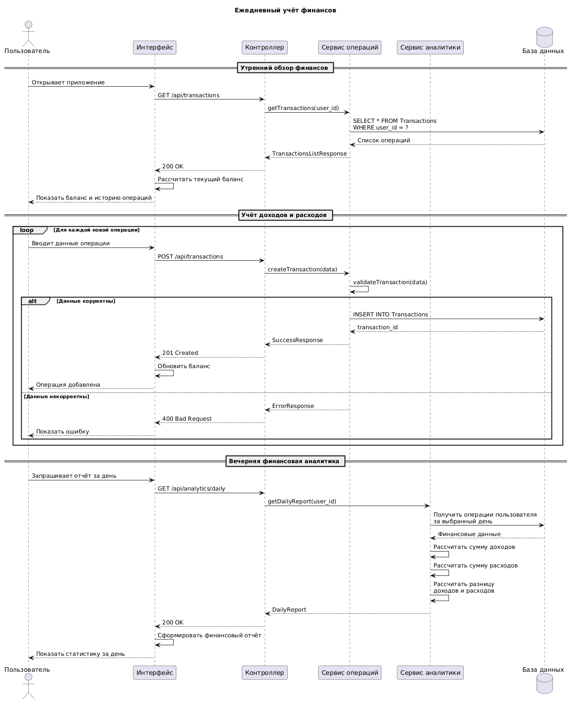

# Диаграммы поведения системы FinanceManager

## Цель работы

Моделирование поведения системы FinanceManager с использованием Use Case диаграммы и диаграмм последовательности.

## Use Case диаграмма

Диаграмма описывает основные сценарии взаимодействия пользователя с системой управления личными финансами.

### Акторы

- Пользователь — основной пользователь системы.

### Основные Use Cases

- Добавление финансовых операций.
- Редактирование финансовых операций.
- Удаление финансовых операций.
- Просмотр истории доходов и расходов.
- Фильтрация операций по категориям и типам.
- Просмотр баланса.
- Просмотр финансовой статистики.
- Валидация данных.
- Сохранение изменений.

## Диаграммы последовательности

### 1. Добавление финансовой операции

Описывает процесс добавления дохода или расхода, проверку введённых данных, сохранение операции в базе данных и обновление баланса.

### 2. Удаление финансовой операции

Демонстрирует процесс подтверждения удаления операции, обработку возможных ошибок и пересчёт баланса пользователя.

### 3. Фильтрация операций по категориям

Описывает получение финансовых операций выбранной категории и отображение результатов пользователю.

### 4. Ежедневный учёт финансов

Комплексный сценарий, включающий утренний обзор финансов, добавление доходов и расходов в течение дня и просмотр итогового финансового отчёта.

## Используемые инструменты

- PlantUML — создание UML-диаграмм.
- GitHub — хранение документации и контроль версий.
- SQLite — проектируемая реляционная база данных.
- Markdown — оформление документации.

## Связь с базой данных

Диаграммы разработаны на основе структуры базы данных, спроектированной в лабораторной работе №4:

- Users — пользователи.
- Categories — категории операций.
- Transactions — финансовые операции.

Диаграммы отражают проектируемое поведение и архитектуру системы.

## Вывод

В ходе лабораторной работы разработана Use Case диаграмма и четыре диаграммы последовательности для ключевых сценариев FinanceManager. Описаны взаимодействия пользователя, интерфейса, контроллера, сервисов и базы данных.
